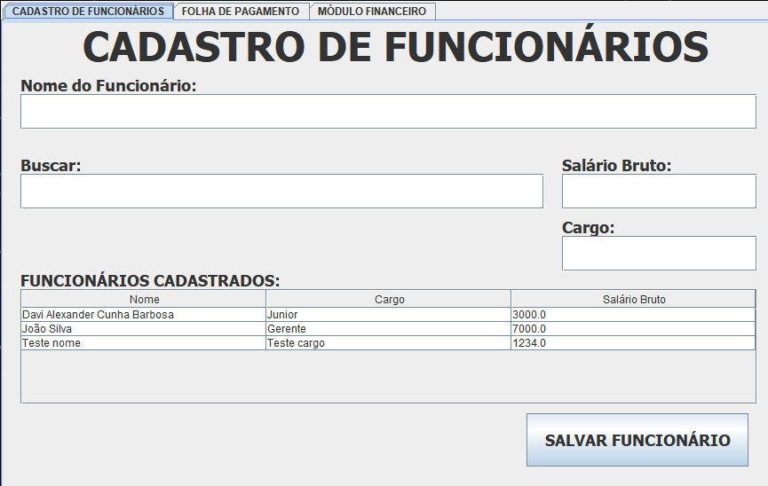
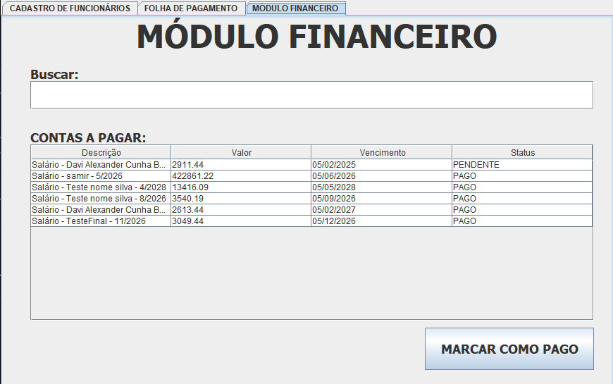
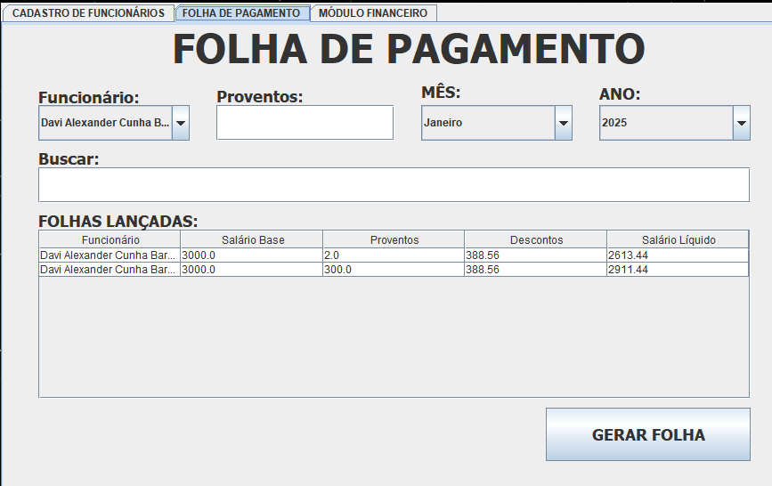

# Sistema de Folha de Pagamento

Sistema desktop em Java para gestão de funcionários e folha de pagamento. Ele calcula INSS e IRRF automaticamente e, a cada folha gerada, cria o lançamento em Contas a Pagar no módulo financeiro.

## Telas

### Cadastro de funcionários


### Módulo financeiro


### Folha de pagamento


## Funcionalidades

**Cadastro de funcionários**
- Cadastro com nome, cargo e salário bruto
- Validação dos campos: não deixa salvar com nome ou cargo vazios ou salário menor ou igual a zero
- Tabela com os funcionários cadastrados e busca em tempo real

**Folha de pagamento**
- Geração da folha por funcionário, mês e ano, com proventos informados na tela
- Cálculo automático de INSS e IRRF por faixas progressivas, chegando ao salário líquido
- Histórico completo das folhas carregado do banco de dados, com busca em tempo real

**Financeiro (Contas a Pagar)**
- Cada folha gerada cria automaticamente uma conta a pagar
- Vencimento calculado no dia 5 do mês seguinte ao mês de referência da folha
- Status da conta: pendente, pago ou vencido
- Botão para marcar como pago, com confirmação antes da ação
- Contas pendentes aparecem antes das pagas, e a tabela também tem busca em tempo real

As três telas ficam em abas, e os dados são atualizados sempre que você troca de aba.

## Tecnologias

- Java
- Swing (interface gráfica, feita no NetBeans)
- JDBC
- MySQL (rodando via XAMPP)

## Como rodar

### 1. Pré-requisitos
- JDK
- NetBeans
- XAMPP, com o **MySQL** iniciado

### 2. Criar o banco de dados
O arquivo [`banco.sql`](banco.sql) cria o banco `PAGAMENTO` e as tabelas `FUNCIONARIOS`, `FOLHAS` e `CONTAS_PAGAR`. Escolha uma das opções:

**Pelo phpMyAdmin**
1. Com o MySQL ligado, abra `http://localhost/phpmyadmin`
2. Clique na aba **SQL**
3. Cole o conteúdo do `banco.sql` e clique em **Executar**

**Pelo terminal (Shell do XAMPP)**
```
mysql -u root < caminho\do\banco.sql
```

### 3. Conferir a conexão
A conexão com o banco fica na classe `ConexaoBD`, no pacote `config`. O padrão do XAMPP é usuário `root` e senha vazia. Se a sua instalação for diferente, ajuste ali.

### 4. Executar
Abra o projeto no NetBeans e execute a tela principal (`TelaPrincipal_GUI`).

## Arquitetura

O projeto segue o padrão MVC com DAO:

```
src/
├── config       # conexão com o banco
├── controller   # controladores das telas
├── dao          # acesso ao banco (Funcionario, Folha, ContaPagar)
├── model        # entidades e enums (ex.: StatusConta)
├── service      # regras de negócio (cálculo da folha e lançamento no financeiro)
└── view         # telas Swing
```

Fluxo principal: ao gerar uma folha, o `FolhaController` salva a folha no banco e chama o `FinanceiroService`, que cria a conta a pagar correspondente.

## Próximos passos

- Editar e excluir funcionários pela tela
- Módulo de histórico
- Tratar o caso de gerar folha sem funcionário selecionado

## Autor

Davi Alexander Cunha Barbosa
[GitHub](https://github.com/Davialexander0310) | [LinkedIn](https://linkedin.com/in/davi-alexander-cunha-barbosa)
